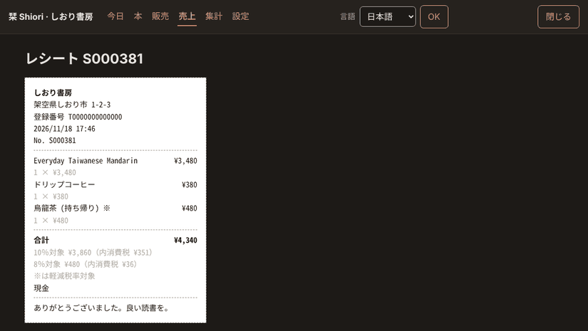
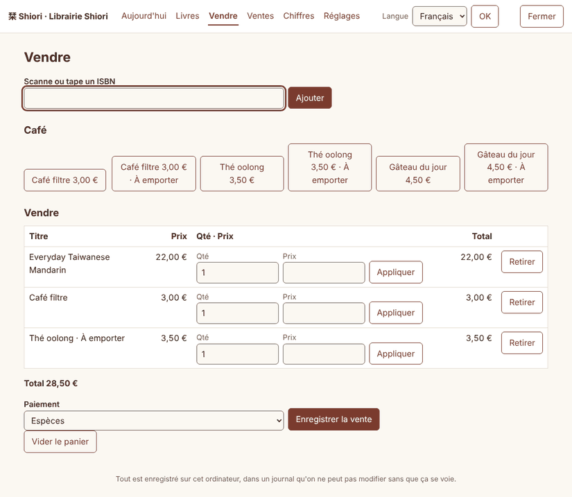

# Shiori 栞

[](https://github.com/thibaultbordrie-cloud/shiori/actions/workflows/ci.yml)


**Open-source software for independent bookshops: catalogue, stock, till and the numbers. It knows the book laws of France, Japan, Taiwan and South Korea. One file runs it on the shop's own computer; nothing leaves the shop.**

*Shiori* (栞) means bookmark.

[日本語](#日本語での概要) · [繁體中文](#中文簡介繁體) · [Français](#en-bref-français)



## What it does

- **Catalogue by ISBN.** Type or scan an ISBN-10 or ISBN-13, with hyphens or full-width digits. Shiori can pre-fill the book from Open Library; only the ISBN is sent. Titles in French, English, Japanese, Chinese and Korean, all searchable.
- **Search the way readers type.** Katakana find hiragana (シオリ = しおり), full-width finds half-width, accents are ignored (*marees* finds *marées*), voicing marks still count (が is not か).
- **Stock.** Deliveries with their cost, the weighted average cost of each title, corrections with a reason (stock count, damaged, lost, given away).
- **Till.** A barcode scanner types the ISBN and presses Enter: the book is in the basket. Café menu, eat in or take away. Discounts are checked against the law **before** the sale is recorded.
- **Receipts** with what each country requires (see [the rules](docs/RULES.md)), printable from the browser.
- **The numbers a bookseller looks at.** Takings and tax per day, bestsellers, sell-through per section, gross margin on books, and the books asleep on the shelves for 90 days.
- **CSV** import and export, the format distributors and spreadsheets share. Exported cells that start with `=`, `+`, `-` or `@` are kept as text, so a spreadsheet does not run them.
- **Four interface languages:** French, English, Japanese, Traditional Chinese.



## The rules it knows

| | France | Japan | Taiwan | South Korea |
|---|---|---|---|---|
| New books | at most 5 % off (Loi Lang) | publisher's price (再販制度) | free price | at most 10 % off (도서정가제) |
| Tax on books | VAT 5.5 % | 10 % | exempt | exempt |
| Café, take away | 10 % | 8 % (軽減税率) | 5 % | 10 % |
| Receipt | VAT by rate | registration no., tax by rate, ※ | | |

France's exception is applied too: a book published over two years ago and last delivered over six months ago may be discounted freely. Sources, details and limits are in [docs/RULES.md](docs/RULES.md). **Shiori is not legal or tax advice, and it is not a certified cash register for France.**

## Built to be trusted

| | |
|---|---|
| **A journal nobody can rewrite unseen** | Every fact (a book, a delivery, a sale, a refund) is one JSON line, flushed to disk before it counts. Each line carries the SHA-256 of the line before it. `shiori verify` finds any line changed, removed or moved. Shiori refuses to open a damaged journal. Only one Shiori can write a journal at a time. |
| **The state is rebuilt, never edited** | Stock, average costs and sales are recomputed from the journal at every start. A test checks that a reopened shop is identical. |
| **Money in whole units** | Cents and whole yen, dollars and won, in 64-bit integers: no floating point. A discount cap is rounded down, so 5 % of 19,99 € allows 0,99 €, never 1,00 €. |
| **Closed to the outside by default** | Served on 127.0.0.1 only. One passphrase, stored as PBKDF2-SHA-256 with 600,000 iterations; a one-minute wait after five wrong tries; sessions in memory only. |
| **Web defences without a framework** | Every change is a POST with a per-session token; requests from another site are refused (Origin); unknown `Host` names get 421, which stops DNS-rebinding pages. Strict Content-Security-Policy and **no JavaScript at all**; every text goes through HTML escaping. |
| **Nothing leaves the shop** | No account, no cloud, no analytics. The Open Library lookup sends only the ISBN, when the bookseller clicks; `--offline` turns it off. |
| **Zero dependency** | Kotlin and the JDK's own HTTP server, crypto and HTTP client. The jar holds the Kotlin standard library and nothing else. |

## Try it

You need Java 21 or later. Download `shiori-0.1.0.jar` from the [latest release](https://github.com/thibaultbordrie-cloud/shiori/releases/latest), then:

```bash
java -jar shiori-0.1.0.jar demo --market tw --data demo-tw   # a fictional shop in Tainan, 8 months of history
java -jar shiori-0.1.0.jar serve --data demo-tw               # then open http://127.0.0.1:8080/
```

The first page asks for a passphrase. Markets: `fr`, `jp`, `tw`, `kr`. Other commands:

```text
shiori verify   --data DIR                 check that the journal was not altered
shiori import   books.csv --supplier NAME  catalogue and stock from a distributor's file
shiori passphrase --data DIR               choose a new passphrase, at the computer
shiori serve    --host 0.0.0.0 --allow-host shop-pc.local:8080   for tablets on the shop's own network
```

All demo books, authors, publishers and shops are invented. Their ISBNs pass the checksum but name no real book.

## Build it

```bash
KOTLINC=/path/to/kotlinc sh build.sh  # build/shiori.jar, then the 41 tests
```

The build uses the official Kotlin compiler and nothing else: no Gradle, no library to download. CI fetches the compiler from JetBrains' GitHub release and checks its SHA-256 before using it. The tests run on Linux, macOS and Windows. They cover ISBN check digits, money in four currencies, tax rounding, each market's discount rules, the journal against tampering, the rebuilt state, search folding, the four translations, the web defences (CSRF, Origin, Host, escaping, lockout), and the four demo shops.

## Next

- Catalogue lookups from the National Diet Library (Japan) and the National Central Library (Taiwan).
- ONIX import, the book trade's standard feed.
- Events and a reading club, with the least personal data possible.
- A Korean interface, and Korea's points (up to 15 % in total).
- An Android tablet till, in Kotlin.

Booksellers, accountants and translators: corrections and ideas are welcome in the issues.

## 日本語での概要

Shiori（栞）は、独立系書店のためのオープンソースのソフトウェアです。ISBNでの書籍登録（Open Libraryから自動入力、送るのはISBNだけ）、在庫と平均仕入れ値、バーコードスキャナー対応のレジ、カフェのメニュー、売上・売れ筋・棚ごとの消化率・90日売れていない本の集計ができます。日本の再販制度（新刊は定価販売）と、適格簡易請求書の記載事項（登録番号、税率ごとの合計と消費税額、軽減税率の※印）に対応しています。すべての記録は改ざんを検知できる帳簿としてお店のパソコンにだけ保存され、外部には何も送られません。日本語の文章は、ネイティブの方の確認を歓迎します。

## 中文簡介（繁體）

Shiori（栞，書籤）是給獨立書店使用的開源軟體：用 ISBN 建立書目（可從 Open Library 帶入，只傳送 ISBN）、庫存與平均進價、支援條碼掃描的結帳、咖啡菜單，以及每日營收、暢銷書、各書區售罄率和 90 天沒賣出的書。它了解台灣沒有圖書統一定價制、圖書免徵營業稅，也了解法國、日本和韓國的規定。所有紀錄都只存在書店自己的電腦上，寫在一本無法被偷偷修改的帳簿裡。目前不開立統一發票。歡迎母語者協助校閱中文內容。

## En bref (français)

Shiori (栞, « marque-page ») est un logiciel libre pour les librairies indépendantes : catalogue par ISBN (pré-rempli depuis Open Library, seul l'ISBN est envoyé), stock et prix d'achat moyen, caisse avec douchette, carte du café, et les chiffres utiles (ventes du jour, meilleures ventes, taux d'écoulement par rayon, livres endormis). Il applique la loi Lang (5 % de remise au plus, remise libre pour les livres de plus de deux ans dont le dernier approvisionnement remonte à plus de six mois) et la TVA à 5,5 %. Tout reste sur l'ordinateur de la librairie, dans un journal qu'on ne peut pas modifier sans que ça se voie. Attention : Shiori n'est pas un logiciel de caisse certifié au sens de l'article 286 du CGI.

## License

MIT.
